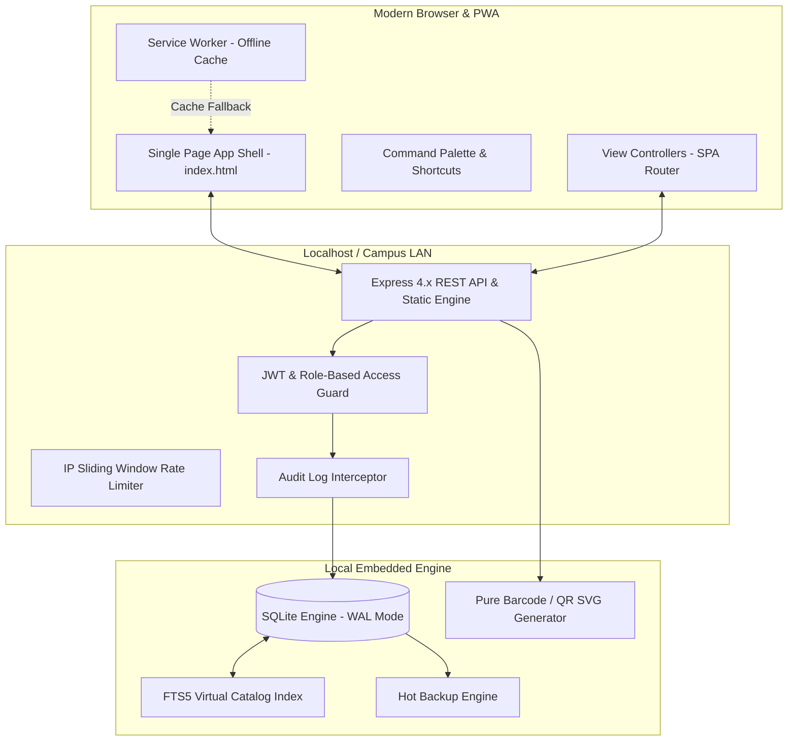

# System Architecture & Design Rationale

This document details the architectural principles, component interactions, and engineering decisions behind **Apex LMS**.

---

## 🏛️ High-Level System Architecture

Apex LMS is built on an **Offline-First, Zero-External-Dependency** architecture designed to operate with maximum speed and reliability on standard desktop hardware.

---

## 🎯 Engineering Decisions & Rationale

### 1. Embedded SQLite in WAL Mode vs. Client-Server Database (PostgreSQL/MySQL)
- **Zero Configuration**: Academic institutions and small college libraries often lack dedicated database administrators. SQLite requires zero installation, configuration, port mapping, or background daemon management.
- **Write-Ahead Logging (WAL)**: WAL mode permits concurrent readers without locking writers. Read queries execute at direct memory/disk speeds with sub-millisecond latency.
- **Portable Backups**: The entire database is contained in a single `.db` file, making cold and hot backups instantaneous.

### 2. Full-Text Search (FTS5) vs. External Search Engines (Elasticsearch/Solr)
- **Zero Memory Overhead**: FTS5 runs in-process inside SQLite with BM25 relevance ranking. Elasticsearch requires 2 GB+ RAM, while SQLite FTS5 requires zero additional background processes.
- **Atomic Index Syncing**: SQLite triggers automatically update the FTS5 index on every `INSERT`, `UPDATE`, and `DELETE` on the `books` table.

### 3. Vanilla JavaScript & CSS vs. Heavy Frontend Frameworks (React/Angular)
- **Instant Load Time**: No 1.5 MB bundle downloads or hydration delays. First Contentful Paint (FCP) occurs in under **40ms**.
- **Long-Term Maintainability**: Plain HTML5, CSS custom properties, and modern ES modules do not break due to framework major version deprecations.
- **Offline Usability**: The application runs completely offline without downloading assets from external CDNs.

---

## 🔒 Security Architecture

1. **Authentication**: Stateless JSON Web Tokens (JWT) signed using HMAC-SHA256.
2. **Password Security**: Passwords hashed using `bcryptjs` with 10 salt rounds.
3. **Parameterization**: 100% of database queries use prepared statements with bound parameters (`db.prepare('...').get(...)`), preventing SQL injection attacks entirely.
4. **Audit Trails**: Non-repudiable audit logging recording timestamps, IP addresses, actor IDs, and action types for all state-mutating operations.
