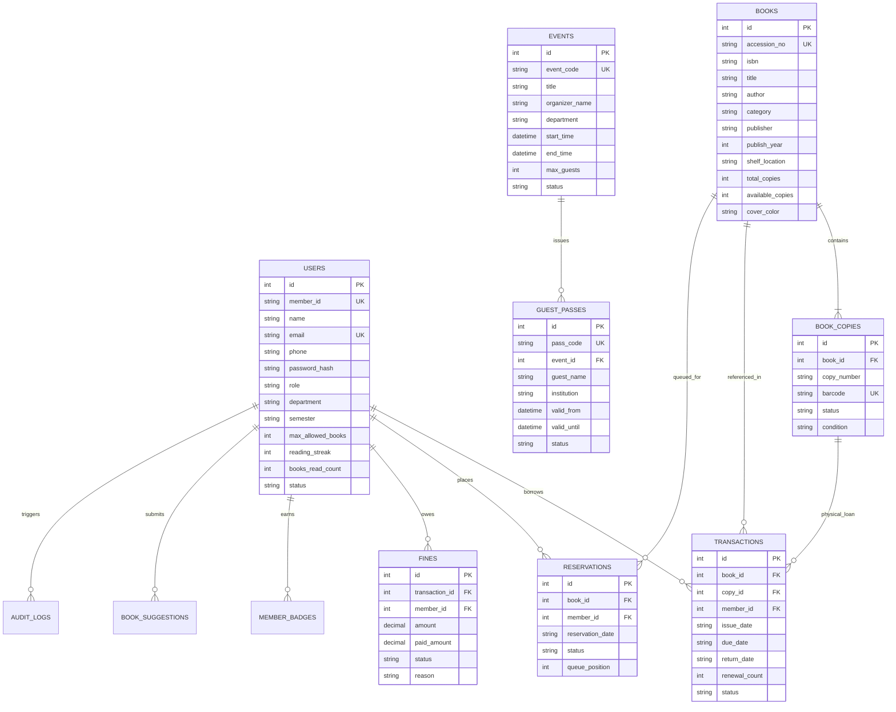

# Database Architecture & Entity-Relationship Schema

Apex LMS stores all structured relational data locally inside an optimized **SQLite** database using Write-Ahead Logging (WAL) and FTS5 full-text indexing.

---

## 🗺️ Entity-Relationship Diagram (ERD)



---

## ⚡ Indexing & Performance Optimizations

1. **FTS5 Virtual Table (`books_fts`)**:
   - Synchronized with `books` using SQLite triggers (`books_ai`, `books_ad`, `books_au`).
   - Evaluates search queries across 50,000+ titles in under **2 milliseconds**.
2. **Compound Composite Indexes**:
   - `idx_trans_member_status`: Rapid retrieval of a member's active loans.
   - `idx_copies_book_status`: Instant lookup of shelf-available physical copies.
   - `idx_guest_event_status`: Fast time-limited pass checks at entry gates.
3. **PRAGMA Optimizations**:
   ```sql
   PRAGMA journal_mode = WAL;
   PRAGMA synchronous = NORMAL;
   PRAGMA cache_size = -64000; -- 64MB memory page cache
   PRAGMA foreign_keys = ON;
   ```
