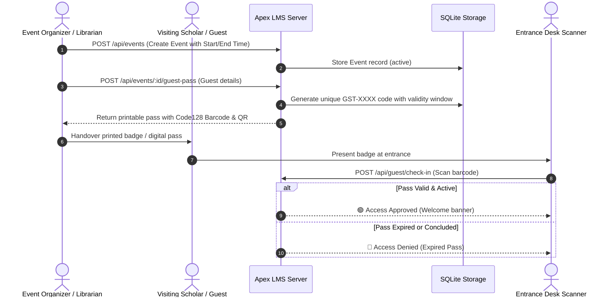

# Event & Temporary Guest Access System

Colleges regularly host academic conferences, research symposiums, hackathons, workshops, and guest lectures. Apex LMS includes a dedicated **Event & Guest Pass Management** module designed to give temporary visitors safe, controlled, and time-bounded library access without creating permanent user accounts.

---

## 🏗️ Architecture & Security Model

---

## 🔑 Key Features of Guest Passes

1. **Strict Time Boundaries**: Passes automatically become active at `start_time` and expire strictly at `end_time`.
2. **Barcode & QR Integration**: Instant scanning with off-the-shelf USB 1D/2D barcode scanners or smartphone cameras.
3. **Optional In-Library Borrowing**: Events can be configured with restricted in-library reference borrowing (e.g., maximum 4 hours, same-day return).
4. **Automatic Anonymization**: Expired guest records are automatically flagged and personal contact info (email/phone) is pruned upon event closure for GDPR/privacy compliance.

---

## 📋 REST API Endpoints for Event Management

| Method | Endpoint | Role | Description |
| :--- | :--- | :--- | :--- |
| `GET` | `/api/events` | Public / Optional | List upcoming and active events |
| `POST` | `/api/events` | Librarian / Admin | Create a new academic event |
| `POST` | `/api/events/:id/guest-pass` | Librarian / Admin | Generate single or bulk guest passes |
| `GET` | `/api/events/:id/guests` | Librarian / Admin | List all registered passes for an event |
| `POST` | `/api/guest/check-in` | Librarian / Admin | Check in guest via barcode scan |
| `POST` | `/api/guest/check-out` | Librarian / Admin | Check out guest |
| `GET` | `/api/guest/verify/:passCode` | Public | Verify pass validity status and time remaining |

---

## 🔒 Privacy & Data Retention Policy

- **Fictional / Ephemeral Data**: Guest records are isolated from the main student roster table (`users`).
- **Data Cleanup**: Once an event status is marked as `closed`, all associated guest contact details (email and phone) can be purged via one-click admin action.
