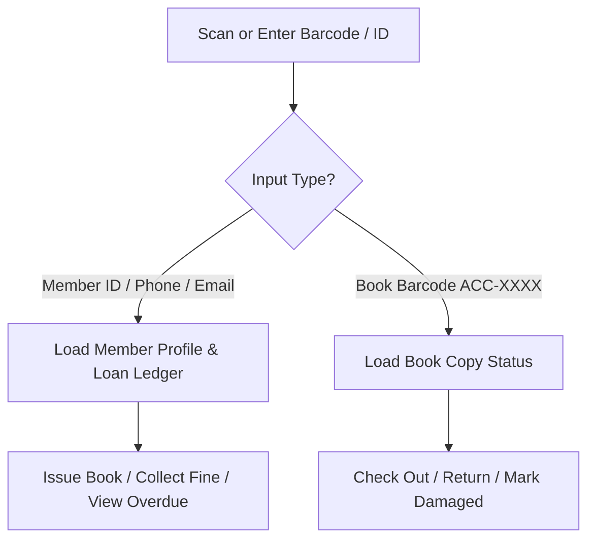

# Apex LMS - Comprehensive User Guide

This guide details day-to-day operations and workflows for all user roles: **Students**, **Faculty**, **Librarians**, and **Event Guests**.

---

## 📖 1. Student Portal

### Searching Books
1. Click **Catalog** in the top navigation or press `Ctrl + K` to open the Command Palette.
2. Enter keywords (e.g., `"Algorithms"`, `"Operating Systems"`, author name, or ISBN).
3. The catalog filters instantly with real-time copy availability badges:
   - 🟢 `Available (N copies)`: Available on shelf.
   - 🔴 `All Copies Issued`: All physical copies checked out.

### Viewing Active Loans & Renewals
1. Navigate to **My Loans**.
2. Review your active borrowed items and due dates:
   - If an item is eligible for renewal, click the **Renew (+14 Days)** button.
   - Items with pending student reservations cannot be renewed to ensure fair queue access.

### Gamification & Badges
- Keep borrowing and reading books to increase your **Reading Streak** 🔥.
- Earn achievement badges:
  - 🔰 **First Reader**: Borrowed first library book.
  - ⚡ **Speed Reader**: Returned 5 consecutive books ahead of due date.
  - 🏆 **Avid Scholar**: Borrowed over 20 titles.

---

## 🎓 2. Faculty Portal

### Privileges & Borrowing Policies
- **Extended Loan Duration**: 30-day default loan period.
- **Higher Quota**: Faculty accounts can borrow up to 10 items concurrently.
- **Departmental Requests**: Recommend new titles directly to the library staff via the **Suggest a Book** portal.

---

## 📚 3. Librarian Circulation Desk

### Scan-First Circulation Workflow
The circulation desk features a single input field that automatically detects barcode scans from USB handheld laser scanners or manual entry:

### Issuing a Book
1. Scan or enter the **Member ID** (e.g., `STU2024001`).
2. Scan the **Book Copy Barcode** (e.g., `ACC-1002-C1`).
3. Click **Issue Book** (or press `Enter`).
4. Due date is automatically computed based on borrower role policy.

### Returning a Book
1. Scan the **Book Barcode** directly into the scanner field.
2. Click **Process Return**.
3. If returned on time, celebratory confetti animates on screen.
4. If overdue, the system computes late fees and presents the fine collection modal.

### Bulk CSV Import
1. Navigate to **Catalog Management** > **Import CSV**.
2. Select an RFC-4180 `.csv` file with headers: `title, author, isbn, category, publisher, year, shelf_location, total_copies`.
3. Preview parsed rows and confirm import.

---

## 🎟️ 4. Event & Guest Access Desk

### Generating Guest Passes
1. Navigate to **Event Access** > **Create Event**.
2. Fill in Event Title, Department, Start Time, and End Time.
3. Click **Issue Guest Pass**, enter the visitor's name and institution.
4. Print the pass containing high-contrast Code128 barcodes and verification QR codes.

### Verifying and Checking In Guests
1. At the library entrance, scan the visitor's pass barcode.
2. System checks pass validity, timestamps, and displays instant clearance:
   - 🟢 `VALID PASS - Welcome to Campus Library`
   - 🔴 `EXPIRED PASS - Event concluded`
